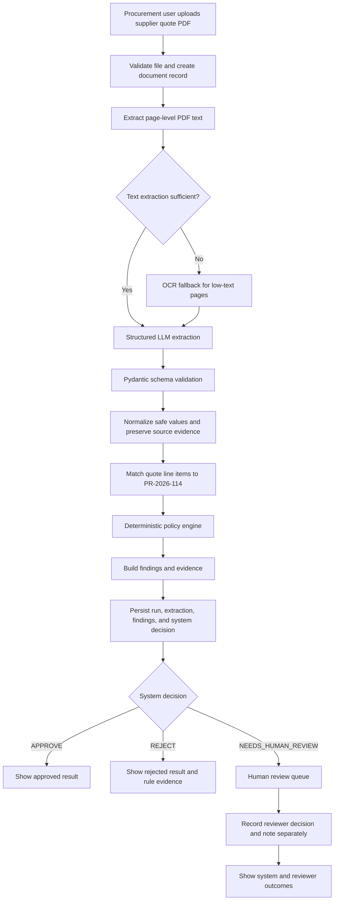
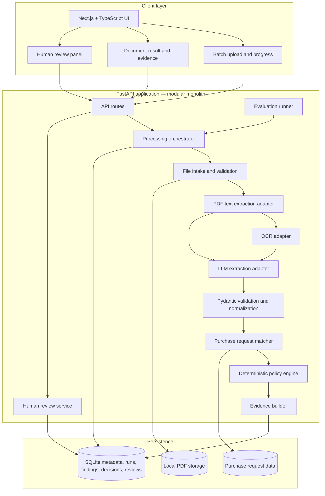
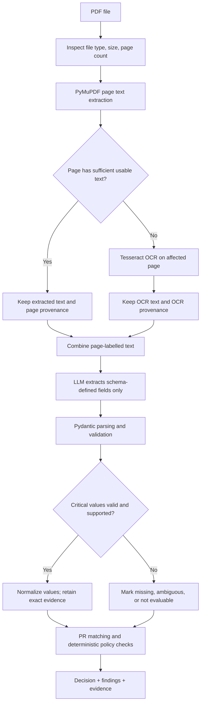
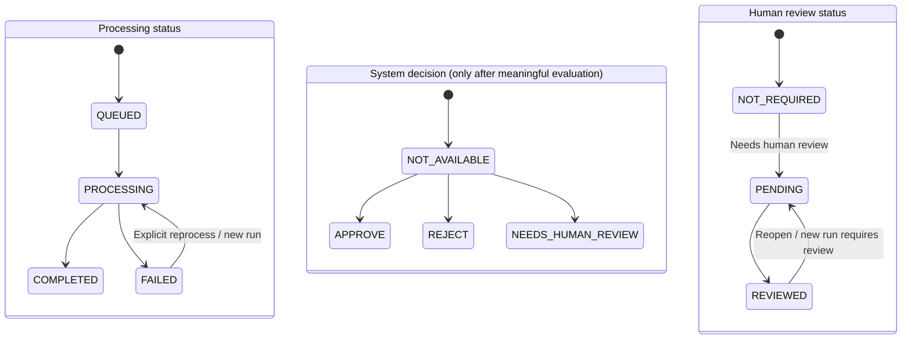
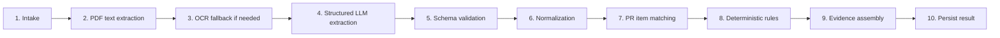
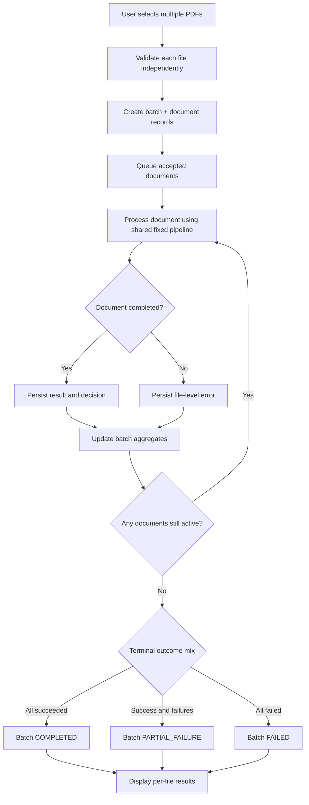
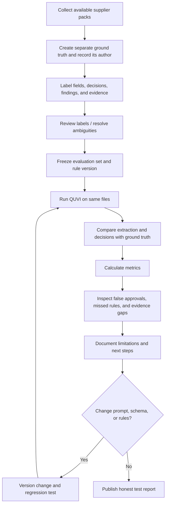
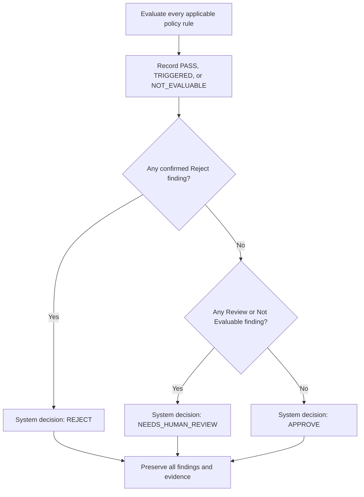
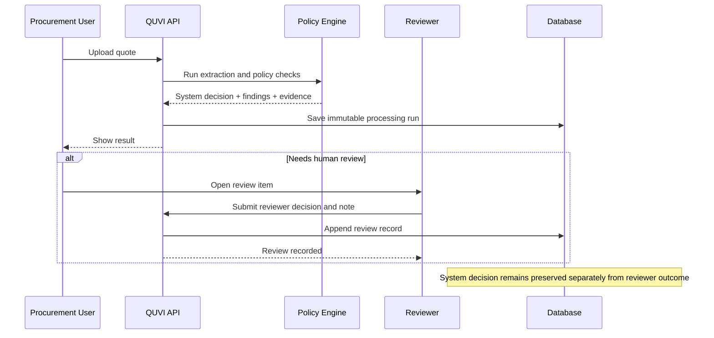

# QUVI — Architecture & Workflow Diagrams

**Project:** QUVI supplier quotation checker  
**Scenario:** Aamar Garments Ltd (fictional)  
**Document purpose:** Visual companion to the project overview, technical architecture, implementation specification, business rules, and evaluation plan.

> These diagrams represent the proposed prototype design. Update them if implementation decisions change. Mermaid diagrams can be rendered by GitHub, many Markdown viewers, Mermaid Live Editor, and supported IDE extensions.

## Diagram index
1. Proposed end-to-end pipeline
2. System architecture
3. Hybrid extraction strategy
4. State model design
5. Fixed processing pipeline
6. Batch lifecycle
7. Evaluation workflow
8. Decision precedence / outcome flow
9. Human review lifecycle

---

## 1. Proposed end-to-end pipeline

**Key principle:** extraction may use AI; policy outcomes are computed by deterministic application code. Uncertainty routes to human review.

---

## 2. System architecture diagram / design

**Prototype stack:** Next.js, TypeScript, Tailwind, shadcn/ui; Python, FastAPI, Pydantic; PyMuPDF; Tesseract OCR fallback; LLM adapter; SQLite; local file storage; pytest.

---

## 3. Hybrid extraction strategy

### Responsibility split

| Component | Responsibility | Must not do |
|---|---|---|
| PDF text reader | Extract embedded text page by page | Infer missing content |
| OCR fallback | Read low-text/scanned pages | Silently replace the original source |
| LLM extractor | Return schema-shaped fields and evidence | Decide Approve/Reject |
| Pydantic validation | Check structure and data types | Guess missing values |
| Normalizer | Apply explicit unit/date/currency mappings | Alter source evidence |
| Rule engine | Apply company thresholds deterministically | Depend on model prose |
| Evidence builder | Link finding to excerpt and page | Invent citations/evidence |

---

## 4. State model design

The **processing state**, **business decision**, and **human review state** are independent dimensions. Avoid using one status field to represent all three.

### State definitions

| Dimension | Values | Meaning |
|---|---|---|
| Document processing | `QUEUED`, `PROCESSING`, `COMPLETED`, `FAILED` | Technical execution lifecycle |
| System decision | `APPROVE`, `REJECT`, `NEEDS_HUMAN_REVIEW`, null | Policy outcome; null if no valid result exists |
| Human review | `NOT_REQUIRED`, `PENDING`, `REVIEWED` | Human review lifecycle |
| Batch | `QUEUED`, `PROCESSING`, `COMPLETED`, `PARTIAL_FAILURE`, `FAILED` | Aggregate status derived from child documents |

A processing failure is not a Reject. A completed document can have a Needs Human Review decision.

---

## 5. Fixed processing pipeline

### Step contracts
1. **Intake:** verify PDF signature, configured size/page limits, hash, and safe storage name.
2. **PDF text extraction:** extract page-level text and quality signals.
3. **OCR fallback:** OCR only low-text or scanned pages; preserve provenance.
4. **Structured extraction:** LLM returns only fields defined by the schema.
5. **Validation:** parse typed fields; reject malformed output; retain null for missing/unclear values.
6. **Normalization:** normalize only with explicit mappings; keep raw text.
7. **PR matching:** match line item identity and unit; flag uncertain matches.
8. **Rules:** apply versioned thresholds in deterministic code.
9. **Evidence:** include exact snippet, page, field/rule link, and extraction source.
10. **Persistence:** save run/version, extraction, findings, decision, and processing state.

---

## 6. Batch lifecycle

### Batch status rules
- `QUEUED`: none started.
- `PROCESSING`: at least one document is active.
- `COMPLETED`: all documents terminal and no file-level failures.
- `PARTIAL_FAILURE`: terminal set contains both successful and failed documents.
- `FAILED`: all documents failed.

**Important:** `NEEDS_HUMAN_REVIEW` is a business outcome, not a batch-processing failure. A batch may be `COMPLETED` while one or more documents need review.

---

## 7. Evaluation workflow

### Evaluation metrics
- Decision accuracy.
- Critical-field exactness.
- Hard-reject recall.
- Review-routing recall.
- False approval rate.
- Evidence coverage.
- Batch resilience.
- Per-document and total latency.

For a ten-file set, include raw counts with percentages. At preparation time, only supplier packs 01 and 02 were available; update the dataset count once remaining packs are provided.

---

## 8. Decision precedence / outcome flow

Policy findings must be retained even when a Reject finding takes precedence over Review findings. Do not let a model-generated narrative override this rule.

---

## 9. Human review lifecycle

---

## Implementation notes
- Keep batch and single-document paths on one processing function.
- Use Decimal/fixed precision for monetary comparisons.
- Preserve exact evidence and page references.
- Keep LLM/provider integration behind an adapter.
- Version prompt, schema, pipeline, and rules.
- Avoid fake confidence scores; uncertainty should be explicit.
- Treat all supplier PDF text as untrusted data, not instructions.
